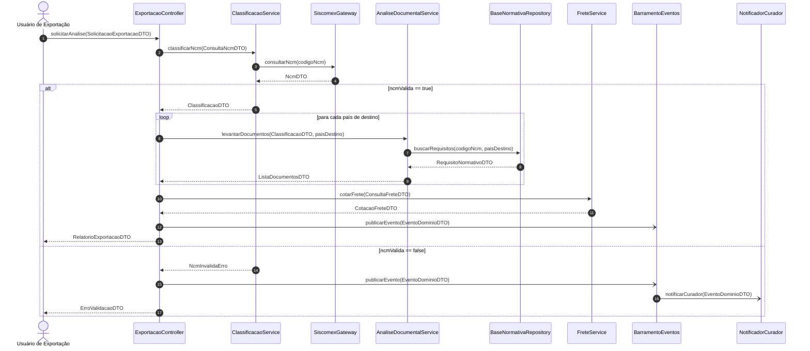
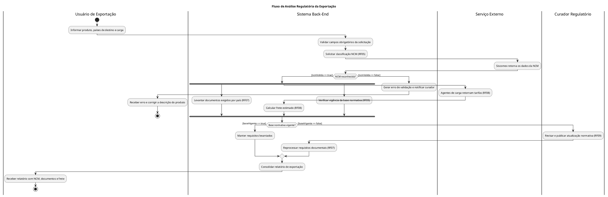
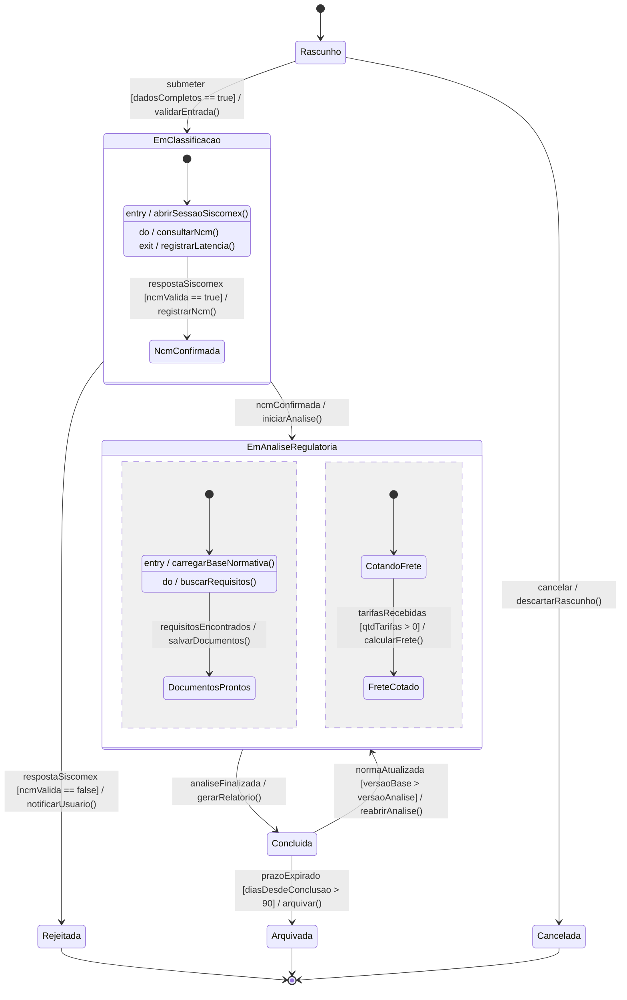
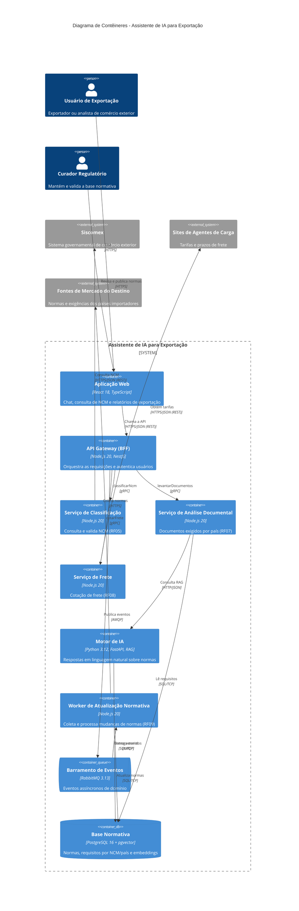

# Assistente de IA para Exportação — Análise Regulatória da Exportação

Documentação técnica (Diagrams as Code) da funcionalidade de **análise regulatória da exportação**.

**Requisitos relacionados**

| Requisito | Descrição (resumo) | Artefatos que o cobrem |
|-----------|--------------------|------------------------|
| RF05 | Consulta e classificação de NCM no Siscomex | 1, 2, 3, 4 |
| RF07 | Análise dos documentos exigidos por país de destino | 1, 2, 3, 4 |
| RF08 | Cálculo de frete com base em agentes de carga | 1, 2, 3, 4 |
| RF09 | Atualização da base normativa pelo curador regulatório | 2, 3, 4, 5 |

> Os diagramas Mermaid renderizam direto no GitHub/GitLab. Os diagramas PlantUML (Artefatos 2) podem ser renderizados em https://www.plantuml.com/plantuml ou pela extensão PlantUML do VS Code.

---

## Estrutura dos artefatos exigidos

A entrega contém obrigatoriamente **5 artefatos técnicos**, codificados em texto declarativo e incorporados neste `README.md`:

| # | Artefato | Ferramenta | Seção |
|---|----------|-----------|-------|
| 1 | Diagrama de Sequência (UML / DaC) | Mermaid | [Artefato 1](#-artefato-1--diagrama-de-sequência-mermaid) |
| 2 | Diagrama de Atividades com Raias (UML / DaC) | PlantUML | [Artefato 2](#-artefato-2--diagrama-de-atividades-com-raias-plantuml) |
| 3 | Diagrama de Transição de Estados (State Machine / DaC) | Mermaid | [Artefato 3](#-artefato-3--diagrama-de-transição-de-estados-mermaid) |
| 4 | Visão Arquitetural Macro C4 (Models-as-Code) | Mermaid | [Artefato 4](#-artefato-4--visão-arquitetural-c4-nível-2-contêineres-mermaid) |
| 5 | Registro de Decisão Arquitetural (ADR 0001) | Markdown (Nygard) | [Artefato 5](#-artefato-5--registro-de-decisão-arquitetural) |

---

## 📄 Artefato 1 — Diagrama de Sequência (Mermaid)

**Objetivo:** mapear a troca cronológica de mensagens entre instâncias em tempo de execução.

**Requisitos técnicos e como foram atendidos**

- ✅ Sintaxe Mermaid (`sequenceDiagram`).
- ✅ Chamadas síncronas bloqueantes com `->>` e chamadas assíncronas/mensageria com `-)` (a seta que o enunciado escreve como `-\>`; no Mermaid a assíncrona é `-)`).
- ✅ Fragmentos combinados: `alt/else` (tratamento de NCM inválida) e `loop` (iteração por país de destino).
- ✅ Retorno de dados com DTOs (`-->>` com `NcmDTO`, `ClassificacaoDTO`, `ListaDocumentosDTO`, `RelatorioExportacaoDTO` etc.).
- ✅ Regra de consistência: toda mensagem para uma linha de vida B corresponde a uma operação pública de B, conforme a tabela de operações abaixo.

Fluxo principal: o usuário solicita a análise, o sistema classifica a NCM no Siscomex, levanta os documentos de cada país de destino, cota o frete e publica eventos de forma assíncrona.

- `->>` : chamada síncrona bloqueante
- `-)` : chamada assíncrona (mensageria)
- `-->>` : retorno de dados (DTO)

### Regra de consistência — operações públicas por classe/interface

Toda mensagem recebida por uma linha de vida corresponde a uma operação pública declarada abaixo.

| Classe / Interface (linha de vida) | Operação pública | Mensagem no diagrama |
|---|---|---|
| `ExportacaoController` | `solicitarAnalise(SolicitacaoExportacaoDTO): RelatorioExportacaoDTO` | Usuário → API |
| `ClassificacaoService` | `classificarNcm(ConsultaNcmDTO): ClassificacaoDTO` | API → CLS |
| `SiscomexGateway` | `consultarNcm(String codigoNcm): NcmDTO` | CLS → SIS |
| `AnaliseDocumentalService` | `levantarDocumentos(ClassificacaoDTO, String paisDestino): ListaDocumentosDTO` | API → DOC |
| `BaseNormativaRepository` | `buscarRequisitos(String codigoNcm, String paisDestino): RequisitoNormativoDTO` | DOC → NOR |
| `FreteService` | `cotarFrete(ConsultaFreteDTO): CotacaoFreteDTO` | API → FRT |
| `BarramentoEventos` | `publicarEvento(EventoDominioDTO): void` | API → MQ |
| `NotificadorCurador` | `notificarCurador(EventoDominioDTO): void` | MQ → NTF |

### DTOs utilizados

| DTO | Campos principais |
|---|---|
| `SolicitacaoExportacaoDTO` | descricaoProduto, paisesDestino[], pesoKg, volumeM3 |
| `ConsultaNcmDTO` | descricaoProduto, codigoNcmInformado (opcional) |
| `NcmDTO` | codigoNcm, descricaoOficial, ncmValida |
| `ClassificacaoDTO` | codigoNcm, descricaoOficial, ncmValida |
| `RequisitoNormativoDTO` | codigoNcm, paisDestino, normas[], versaoBase |
| `ListaDocumentosDTO` | paisDestino, documentos[], observacoes |
| `ConsultaFreteDTO` | paisDestino, pesoKg, volumeM3 |
| `CotacaoFreteDTO` | agente, valor, moeda, prazoDias |
| `EventoDominioDTO` | tipo, idAnalise, dataHora, payload |
| `RelatorioExportacaoDTO` | classificacao, documentosPorPais[], cotacoes[] |
| `ErroValidacaoDTO` | codigo, mensagem, campo |

---

## 📄 Artefato 2 — Diagrama de Atividades com Raias (PlantUML)

**Objetivo:** mapear o fluxo de trabalho (workflow) e a concorrência do processo de negócio.

**Requisitos técnicos e como foram atendidos**

- ✅ Sintaxe PlantUML (o Mermaid não possui raias nativas).
- ✅ 4 raias de partição (mínimo exigido: 3): Usuário de Exportação, Sistema Back-End, Serviço Externo e Curador Regulatório.
- ✅ Nós de decisão com condições de guarda mutuamente exclusivas: `[ncmValida == true]` × `[ncmValida == false]` e `[baseVigente == true]` × `[baseVigente == false]`.
- ✅ Execução paralela com Barra de Fork (`fork` / `fork again`) e Barra de Join (`end fork`): levantamento de documentos (RF07), cálculo de frete (RF08) e verificação da base normativa (RF09).

O Mermaid não possui raias nativas; por isso este artefato usa PlantUML. São 4 raias, decisões com guardas mutuamente exclusivas e execução paralela com **Fork** e **Join** (`fork` … `end fork`).

---

## 📄 Artefato 3 — Diagrama de Transição de Estados (Mermaid)

**Objetivo:** mapear o ciclo de vida rigoroso da entidade de domínio principal (`AnaliseExportacao`).

**Requisitos técnicos e como foram atendidos**

- ✅ Sintaxe Mermaid `stateDiagram-v2`.
- ✅ Estado inicial (`[*] --> Rascunho`), subestados (`EmClassificacao` e `EmAnaliseRegulatoria`, este com regiões concorrentes) e três estados terminais (`Rejeitada`, `Arquivada`, `Cancelada`).
- ✅ Sintaxe formal `Gatilho [CondiçãoDeGuarda] / AçãoDeEfeito()` em várias setas, por exemplo `submeter [dadosCompletos == true] / validarEntrada()` e `prazoExpirado [diasDesdeConclusao > 90] / arquivar()`.
- ✅ Ações internas nos estados `ConsultandoSiscomex` (`entry /`, `do /`, `exit /`) e `LevantandoDocumentos` (`entry /`, `do /`).

Entidade principal: **`AnaliseExportacao`**. Contém estado inicial, subestados, regiões concorrentes, estados terminais, transições no formato `Gatilho [Guarda] / Ação()` e compartimentos internos `entry /`, `do /` e `exit /`.

---

## 📄 Artefato 4 — Visão Arquitetural C4 Nível 2: Contêineres (Mermaid)

**Objetivo:** representar a topologia e as unidades de implantação do sistema.

**Requisitos técnicos e como foram atendidos**

- ✅ Visão de Contêineres (C4 Nível 2).
- ✅ Ferramenta avançada: Mermaid (`C4Container`).
- ✅ Tecnologias explícitas em cada contêiner (React 18, Node.js 20/NestJS, Python/FastAPI, RabbitMQ 3.13, PostgreSQL 16) e protocolos nos conectores (HTTPS/JSON, gRPC, AMQP, SQL/TCP).

---

## 📄 Artefato 5 — Registro de Decisão Arquitetural

**Objetivo:** documentar e justificar a escolha de uma decisão de infraestrutura ou padrão da funcionalidade.

**Estrutura obrigatória (formato Nygard):** Título (`ADR 0001 — [Nome da Decisão]`), Status (Aprovado / Proposto), Contexto (problema técnico ou de negócio), Decisão (tecnologia, protocolo ou padrão adotado e por quê) e Consequências (vantagens e débitos/riscos aceitos).

### ADR 0001 — Adoção de mensageria assíncrona com RabbitMQ para eventos e atualização da base normativa

**Status:** Proposto

**Contexto:**
A análise regulatória depende de fontes externas lentas e instáveis (Siscomex, agentes de carga, fontes de mercado dos países de destino). Além disso, a atualização da base normativa (RF09) é um processo demorado, com revisão humana do curador regulatório, e não pode bloquear a resposta ao usuário. Chamadas síncronas encadeadas aumentariam a latência, acoplariam os serviços e fariam falhas externas derrubarem a análise inteira. Também é necessário avisar o curador quando uma NCM ou norma não for encontrada e reabrir análises já concluídas quando uma norma mudar.

**Decisão:**
Adotar o **RabbitMQ 3.13** (protocolo **AMQP**) como barramento de eventos entre os contêineres. As chamadas que precisam de resposta imediata (classificar NCM, levantar documentos, cotar frete) continuam síncronas via **gRPC**. Os eventos de domínio (`AnaliseConcluida`, `NcmNaoEncontrada`, `NormaAtualizada`) são publicados em *exchanges* do tipo *topic*, com filas duráveis e *dead-letter queue* para mensagens com falha. O RabbitMQ foi escolhido em vez de Kafka por oferecer roteamento flexível, operação simples e volume de mensagens compatível com o porte do sistema, sem exigir *replay* de longo prazo.

**Consequências:**

*Vantagens*
- Desacoplamento entre serviços e o processo de atualização normativa.
- Resiliência: falhas temporárias de fontes externas são tratadas com reentrega e *retry*.
- Resposta ao usuário não fica bloqueada por tarefas demoradas ou por revisão humana.
- Facilidade para adicionar novos consumidores (ex.: auditoria) sem alterar o produtor.

*Débitos e riscos aceitos*
- Mais um componente de infraestrutura para operar, monitorar e proteger.
- Consistência eventual: o relatório pode refletir uma norma ainda não atualizada.
- Necessidade de consumidores idempotentes, pois a entrega é *at-least-once*.
- Maior complexidade de depuração e rastreamento (exige *correlation id* nas mensagens).
